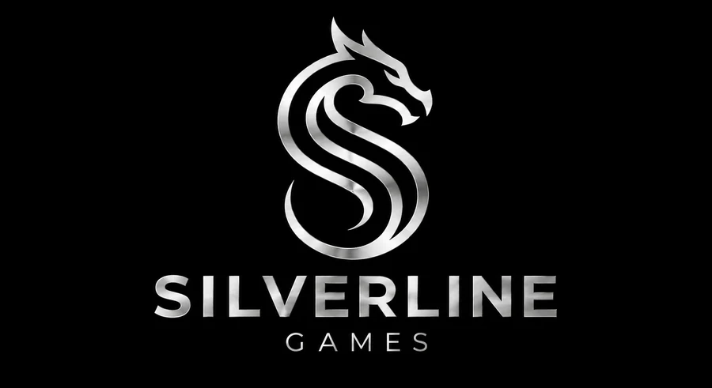

<p align="center">
  
</p>

<h1 align="center">Silverline Games — Sitio del estudio</h1>

<p align="center">
  Sitio de presentación de <strong>Silverline Games</strong>, estudio independiente
  de videojuegos: historia, cooperativo, acción y más géneros por venir.
  Presenta a <strong>EDR</strong>, nuestro primer juego, ya en desarrollo.
</p>

---

## Secciones

| Sección | Contenido |
| --- | --- |
| **Inicio** | Presentación del estudio con fondo 3D (rejilla en perspectiva, fragmentos y parallax) |
| **EDR** | Nuestro primer juego: historia, cooperativo y acción — muy pronto en Steam |
| **Filosofía** | Originalidad, todos los géneros, accesibilidad y evolución |
| **Inversión** | Plan claro: $1,745 MXN (Claude) + $1,745 MXN (Steam) entre 4 socios |
| **Ventas** | Precio de $5–10 USD en Steam y meta mínima de 100 copias por juego: matemática de ingresos, escalera de metas (100 → 500 → 1,000) y cómo lograr las primeras ventas |
| **Crecimiento** | Regalo de EDR a creadores de contenido + promoción directa del estudio |
| **Equipo** | Alvaro (CEO y Director de Gameplay y Desarrollo), Alaniz, Adán y Ragnar |
| **Ruta** | Hoja de ruta: empezar simple, subir el nivel, crecer como estudio |

## Tecnología

- [Next.js 16](https://nextjs.org) (App Router) + React 19 + TypeScript
- [Tailwind CSS 4](https://tailwindcss.com) + componentes de [shadcn/ui](https://ui.shadcn.com)
- [Framer Motion](https://www.framer.com/motion/) para animaciones de entrada
- Efectos 3D con **CSS puro** (perspectiva, tilt de tarjetas y parallax) — sin WebGL, carga ultrarrápida
- Imágenes optimizadas en WebP

## Desarrollo

```bash
npm install
npm run dev        # http://localhost:3000
```

## Compilación

```bash
npm run build      # build de producción
npm start          # sirve el build
```

Para generar un sitio estático (el que usa GitHub Pages):

```bash
NEXT_STATIC_EXPORT=1 NEXT_PUBLIC_BASE_PATH=/sl-info npm run build   # resultado en ./out
```

## Despliegue

- **GitHub Pages (automático):** cada push a `main` ejecuta el workflow
  [`.github/workflows/deploy.yml`](.github/workflows/deploy.yml), que compila el
  sitio y lo publica en **https://silverlinegames.github.io/sl-info/**
- **Vercel (alternativa):** importa este repositorio en
  [vercel.com](https://vercel.com) — cero configuración, usa el build normal
  (sin `basePath`).

## Estructura

```
src/
  app/
    page.tsx           # landing completa (una sola página)
    layout.tsx         # metadatos (SEO) y fuentes
    globals.css        # estilos del tema + animaciones 3D del hero
    icon.png           # favicon (emblema del dragón)
  components/
    hero-backdrop.tsx  # fondo 3D del hero: rejilla, fragmentos y chispas (CSS)
    tilt-card.tsx      # tarjetas con efecto tilt 3D al pasar el ratón
    ui/                # componentes base (button, sheet, toast)
  hooks/ lib/          # utilidades
public/
  silverline-logo.webp   # logo completo
  silverline-emblem.webp # emblema del dragón
```

---

© 2026 Silverline Games. Todos los derechos reservados.
